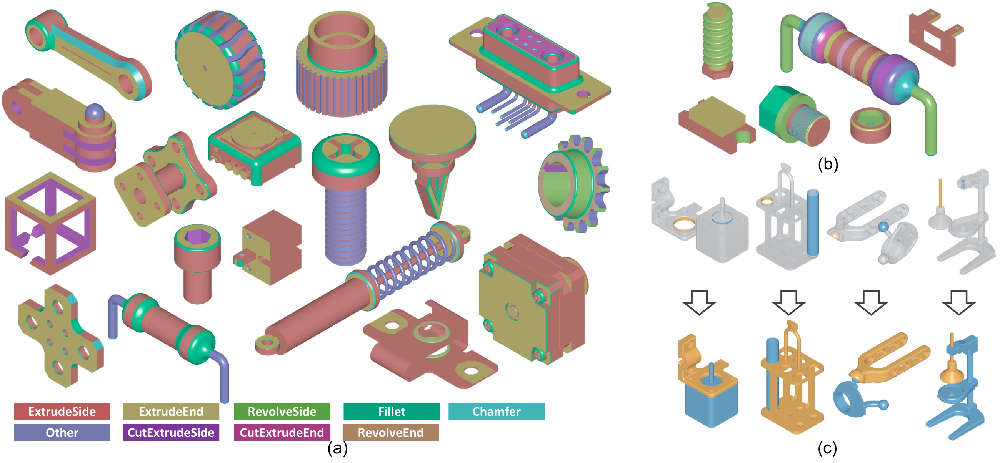
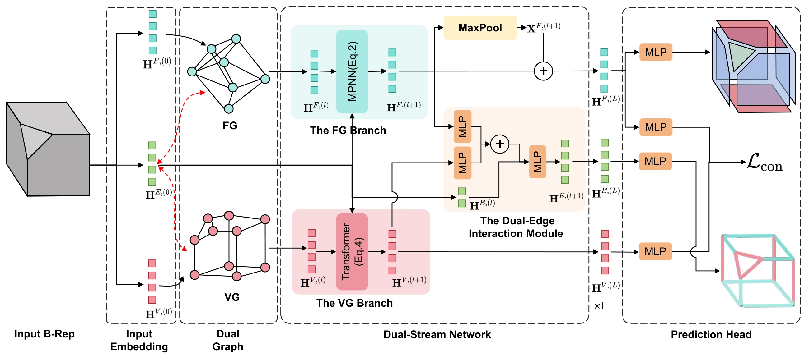

# BRepDSN

### A Dual-stream Network Design for B-Rep Representation Learning Leveraging the Duality of Face and Boundary Vertices

Haoxuan Song*, Bingchen Yang*, Jun Xiao, Peter Wonka, Haiyong Jiang

*Equal contribution. Haiyong Jiang is the corresponding author and project lead.*

**[Project Page](https://shinodashx.github.io/BrepDSN/)** · **[Code](https://github.com/shinodashx/BrepDSN)**

BRepDSN is a dual-stream network for B-Rep representation learning that leverages complementary features from a Face-adjacency Graph (FG) and a Vertex-adjacency Graph (VG). Bidirectional feature exchange, face-vertex contrastive learning, and auxiliary boundary classification enable boundary-aware and semantically aligned feature encoding.

[](https://shinodashx.github.io/BrepDSN/)

## Method

- **Dual-stream feature encoding.** The FG branch encodes face adjacency, while the VG branch captures vertex connectivity and boundary structure. A dual-edge interaction module exchanges information between the two streams.
- **Face-vertex contrastive learning.** A face embedding is aligned with the aggregated embedding of its boundary vertices.
- **Boundary classification.** An auxiliary edge classification objective complements face segmentation by identifying edges between faces with different labels.



## Main files

- [`graphgym/main.py`](graphgym/main.py), [`run.sh`](run.sh): training and evaluation entrypoints.
- [`graphgym/configs/2025_0625_Brep_CC3D_Full_Enhanced_SL_Final.yaml`](graphgym/configs/2025_0625_Brep_CC3D_Full_Enhanced_SL_Final.yaml): CC3D modeling operation segmentation configuration.
- [`graphgym/custom_graphgym/encoder/`](graphgym/custom_graphgym/encoder/): face, edge, and vertex feature encoders.
- [`graphgym/custom_graphgym/layer/`](graphgym/custom_graphgym/layer/), [`network/`](graphgym/custom_graphgym/network/): dual-stream graph layers and network construction.
- [`graphgym/custom_graphgym/head/`](graphgym/custom_graphgym/head/), [`loss/`](graphgym/custom_graphgym/loss/): face segmentation, auxiliary boundary classification, and face-vertex contrastive learning.
- [`graphgym/custom_graphgym/loader/dataset_BRep.py`](graphgym/custom_graphgym/loader/dataset_BRep.py): paired face/vertex graph datasets and batching.
- [`torch_geometric/`](torch_geometric/): the project's PyG 2.6.0 implementation, including GraphGym training, evaluation, metrics, and checkpoint utilities.
- [`docs/`](docs/): project page, figures, and results.

## Installation

The training environment uses Python 3.8, PyTorch 1.13.0, and CUDA 11.7.

```bash
git clone https://github.com/shinodashx/BrepDSN.git
cd BrepDSN

conda create -n brepdsn python=3.8 -y
conda activate brepdsn
python -m pip install "pip<24.1"
python -m pip install torch==1.13.0+cu117 torchvision==0.14.0+cu117 \
  --extra-index-url https://download.pytorch.org/whl/cu117
python -m pip install torch-scatter==2.1.1 torch-sparse==0.6.17 torch-cluster==1.6.1 \
  -f https://data.pyg.org/whl/torch-1.13.0+cu117.html
python -m pip install -r requirements.txt
```

PyG is loaded from the bundled `torch_geometric/` directory. Its upstream license is included in [`torch_geometric/LICENSE`](torch_geometric/LICENSE).

## Configure data

Place the processed CC3D graphs and split files under `datasets/CC3D/`:

```text
datasets/
└── CC3D/
    ├── CC3D_V3_2.pkl
    ├── Unit_bbox.pkl
    └── data_split.json
```

`CC3D_V3_2.pkl` maps model names to paired face/vertex graph features, connectivity, dual mappings, and labels. `Unit_bbox.pkl` contains the `unit_bbox` graph. `data_split.json` contains `train` and `test` lists of model names; the loader uses `test` for validation and evaluation.

Set these fields in the YAML configuration:

| Setting | Meaning | Default |
| --- | --- | --- |
| `dataset.dir` | Processed graph pickle; the split JSON and bounding-box pickle are read from the same directory. | `datasets/CC3D/CC3D_V3_2.pkl` |
| `out_dir` | Training outputs and checkpoints. | `results` |
| `train.batch_size` | Training batch size. | `16` |
| `optim.max_epoch` | Number of training epochs. | `300` |

Run commands from the repository root. Configuration values can also be passed as command-line overrides.

## Training and evaluation

Train the dual-stream model with auxiliary boundary classification and face-vertex contrastive learning:

```bash
CFG=graphgym/configs/2025_0625_Brep_CC3D_Full_Enhanced_SL_Final.yaml
python graphgym/main.py --cfg "$CFG" seed 4
```

To use a different dataset location:

```bash
python graphgym/main.py --cfg "$CFG" \
  dataset.dir /path/to/CC3D/CC3D_V3_2.pkl seed 4
```

The launcher runs the default configuration on GPU 0 in the background and writes a timestamped log under `logs/`:

```bash
bash run.sh
```

Checkpoints are saved to `results/2025_0625_Brep_CC3D_Full_Enhanced_SL_Final/4/ckpt/`. Evaluate checkpoint `299.ckpt` with:

```bash
python graphgym/main.py --cfg "$CFG" --eval seed 4 train.epoch_resume 299
```

Evaluation writes face and boundary metrics, `val_result.pkl`, and `test_result.pkl` to the run directory. Resume training from an earlier checkpoint with:

```bash
python graphgym/main.py --cfg "$CFG" seed 4 \
  train.auto_resume True train.epoch_resume 199
```

## Results

BRepDSN is evaluated on modeling operation segmentation, operation step segmentation, B-Rep classification, machining feature segmentation, and assembly mating.

| Dataset | Task | Metric | BRepDSN |
| --- | --- | --- | ---: |
| Fusion360 | Modeling operation segmentation | mIoU | 88.50% |
| CC3D | Modeling operation segmentation | mIoU | 60.35% |
| CC3D-Ops | Operation step segmentation | Step accuracy | 66.23% |
| TMCAD | B-Rep classification | Overall accuracy | 89.68% |
| MFCAD++ | Machining feature segmentation | mIoU | 99.01% |

## Citation

```bibtex
@misc{song_brepdsn,
  title  = {BRepDSN: A Dual-stream Network Design for B-Rep
            Representation Learning Leveraging the Duality
            of Face and Boundary Vertices},
  author = {Song, Haoxuan and Yang, Bingchen and Xiao, Jun
            and Wonka, Peter and Jiang, Haiyong},
  url    = {https://github.com/shinodashx/BrepDSN}
}
```
